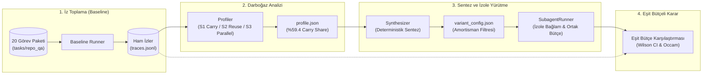

<div align="center">


# boundary.

**Çoklu ajan (multi-agent) sınırlarını sezgiyle değil, ampirik iz (trace) verisiyle belirleyin.**  
*Measure whether an agent system actually needs sub-agent boundaries.*

[](https://github.com/egeyasar0/boundary./actions/workflows/ci.yml)
[](https://www.python.org/)
[](https://docs.pydantic.dev/)
[](https://github.com/astral-sh/ruff)
[](https://mypy-lang.org/)
[](./LICENSE)

[**Problem**](#-1-problem-sezgisel-çoklu-ajan-yanılgısı-ve-taşıma-maliyeti) •
[**Ampirik Bulgular**](#-2-ampirik-doğrulama-gerçek-benchmark-sonuçları) •
[**Mimari**](#-3-çözüm-boundary-mimarisi) •
[**CLI Kullanımı**](#-4-cli-kullanımı) •
[**Kurulum**](#-5-kurulum-ve-yapılandırma)

</div>

---

## 🚨 1. Problem: Sezgisel Çoklu Ajan Yanılgısı ve Taşıma Maliyeti

Modern yapay zeka mühendisliğinde çoklu ajan (*multi-agent*) topolojileri çoğu zaman **ampirik veri olmadan, tamamen sezgisel olarak** kurgulanır. Geliştiriciler henüz tek bir ajanın darboğazlarını ölçmeden sistemi "Planner", "Researcher", "Coder" ve "Reviewer" gibi alt ajanlara böler. Oysa saha ölçümleri iki kritik gerçeği ortaya koymaktadır:

1. **Sezgisel Bölünme Maliyeti Artırır:** Eşit token bütçesi altında, rastgele kurgulanan çoklu ajan sistemleri koordinasyon ve el değiştirme (*handoff*) yükü nedeniyle tekil ajan (*single-agent baseline*) performansını çoğu zaman geçemez.
2. **Asıl Düşman Bağlam Kirliliği (*Context Bloat*) ve Taşıma Maliyetidir (*Carry Cost*):** Tek bir ajan döngüsünde çağrılan her aracın (`read_file`, `grep`, `list_files`) ürettiği ham çıktı, konuşma geçmişine (*message history*) eklenir ve **görev bitene kadar sonraki her adımda modele tekrar tekrar gönderilir**.

```text
Adım 1: [Sistem + Görev] + [Tool Çıktısı #1 (4.000 token)]                  ->  4.200 prompt token
Adım 2: [Sistem + Görev] + [Tool #1 (4.000)] + [Tool #2 (6.000)]            -> 10.400 prompt token
Adım 3: [Sistem + Görev] + [Tool #1 (4.000)] + [Tool #2 (6.000)] + [Tool #3] -> 18.000+ prompt token
        └──────────────────────────┬───────────────────────────┘
                     Atıl Taşıma Maliyeti (Carry Cost)
```

Bir aracın 2. adımda ürettiği 6.000 tokenlık dosya içeriği, yalnızca içinden birkaç satırlık bir bilgi çekmek için okunmuş olsa bile sonraki tüm adımlarda sırt çantasında taşınan bir yük (*carry cost*) haline gelir.

> [!IMPORTANT]
> **boundary. Temel Felsefesi:** *"Önce tek ajan (baseline); alt ajan sınırını yalnızca veri ve token ekonomisi haklı çıkarırsa ekle."*

---

## 📊 2. Ampirik Doğrulama: Gerçek Benchmark Sonuçları

**boundary.** geliştirilirken varsayımlar yerine **20 görevlik gerçekçi bir kod tabanı analiz paketi (`tasks/repo_qa`)** üzerinde `40.000` token bütçesiyle tekil ajan izleri (*traces*) toplanmış ve adım bazlı token ekonomisi ölçülmüştür.

Elde edilen ampirik bulgular, ajan sistemlerindeki gizli verimsizliği net biçimde kanıtlamaktadır:

| Metrik | Ölçülen Değer | Mühendislik Anlamı |
| :--- | :---: | :--- |
| **Test Paketi Kapsamı** | **20 Görev** | Kolay (tek dosya), Orta (çoklu dosya) ve Zor (800+ satırlık dosyalarda *multi-hop*, *count*, *distractor*) senaryoları |
| **Ortalama Carry Share (Taşıma Payı)** | **%59.4** | Harcanan toplam prompt tokenlarının **neredeyse %60'ı** yeni akıl yürütme için değil, önceki adımların eski tool çıktılarını taşımak için yakılmaktadır. |
| **Başarısız Görevlerde Bütçe Aşımı** | **%105 – %146** | Batan görevler (`stop_reason="budget"`), modelin yetersizliğinden değil, **sırtında taşıdığı atıl tool çıktıları yüzünden** bütçe duvarına çarpmasından kaynaklanmaktadır. |
| **Tespit Edilen Alt Ajan Fırsatı** | **32 Aday Sınır** | Düşük yeniden kullanım oranı (`reuse_ratio < 0.015`) ve yüksek taşıma maliyetine (`carry_cost > 20.000` token) sahip `extract_subagent` noktaları. |

### Neden Görevler Başarısız Oluyor?

Analiz edilen izlerde, başarısız olan görevlerin tamamı doğru dosyayı ve doğru kod bloğunu tespit etmesine rağmen, arama sürecinde (`grep` ve geniş `read_file` çağrıları) bağlama giren yüksek hacimli metinleri her yeni adımda tekrar ödediği için token bütçesini **%105 ila %146 oranında** zorlayarak yarıda kesilmiştir:

* **Yetersizlik Değil, Bağlam Boğulması:** Model doğru iz üzerindedir ancak önceki adımlardan kalan atıl çıktılar bütçeyi bitirir.
* **Alt Ajanın Gerçek Rolü:** Alt ajan (*sub-agent*) "daha zeki olmak" için değil, **yüksek hacimli araç çıktılarını izole bir bağlamda tüketip ana ajana yalnızca filtrelenmiş/özetlenmiş cevabı döndürerek %59.4'lük taşıma maliyetini kırmak** için vardır.

---

## 🏗️ 3. Çözüm: Boundary Mimarisi

**boundary.**, tekil bir ajanın çalışma izlerini (*traces*) girdi olarak alır ve **Profiler $\rightarrow$ Synthesizer $\rightarrow$ SubagentRunner** döngüsüyle yalnızca kendini amorti eden alt ajan sınırlarını sentezler ve doğrular.



### Çekirdek Döngü: `Profiler` $\rightarrow$ `Synthesizer` $\rightarrow$ `SubagentRunner`

#### 1. `Profiler` (Deterministik İz ve Darboğaz Analizörü)
Ağ veya LLM çağrısı yapmadan doğrudan `traces.jsonl` kayıtlarını tarar ve üç temel sinyal üretir:
* **S1 — Taşıma Maliyeti (*Carry Cost*):** $N$ adımlı bir izde, $s$. adımda üretilen bir araç çıktısının kalan $(N - 1 - s)$ çağrıda yaratacağı toplam yükü hesaplar:
  $$\text{carry\_cost}(r_s) = \text{tokens\_est}(r_s) \times (N - 1 - s)$$
* **S2 — Yeniden Kullanım Oranı (*Reuse Ratio*):** Araç çıktısındaki anlamlı tanımlayıcıların sonraki adımlarda (`assistant_content`, `tool_calls`, `final_answer`) gerçekten kullanılıp kullanılmadığını ölçer. Boyutu yüksek ($\ge 2000$ token) ve yeniden kullanım oranı düşük ($< 0.1$) adımlar `extract_subagent` fırsatı olarak işaretlenir.
* **S3 — Bağımsızlık (*Parallelizability*):** Veri bağımlılığı olmayan ardışık araç adımlarını tespit eder.

#### 2. `Synthesizer` (Amortisman Odaklı Sınır Sentezleyici)
`profile.json` içindeki `extract_subagent` fırsatlarını okuyarak LLM kullanmadan, deterministik olarak bir mimari varyant (`variant_config.json`) sentezler. Bir alt ajan **yalnızca kendini amorti ettiğinde** devreye alınır:
* Bağlamı şişiren doğrudan `read_file` / `grep` çağrıları yerine, hedef dosyayı izole bir bağlamda inceleyen delegasyon sınırları (`delegate_inspection` / `delegate_search`) enjekte edilir.

#### 3. `SubagentRunner` (İzole Bağlam ve Konsolide Bütçe Yürütücüsü)
Sentezlenen alt ajanları iki katı kuralla çalıştırır:
* **İzole Bağlam (R11):** Alt ajan, ana ajanın konuşma geçmişini görmez. Kendi kısa ömürlü döngüsünde (`subagent_max_steps=3`, `subagent_budget=8000`) devasa dosyayı okur ve ana ajana yalnızca aranan bilgiyi içeren kısa özeti ($\le 300$ token) tek bir `ToolResult` olarak döner.
* **Konsolide Bütçe Muhasebesi (R12):** Alt ajanın harcadığı her prompt ve completion tokenı, ana ajanın global `token_budget` kotasından düşülür. Alt ajan bedava değildir; taşıma maliyetinden kurtardığı tokenlarla kendi maliyetini amorti etmek zorundadır.

---

### Değişmez Mimari İlkeler (R1–R13)

| Kural | İlke | Açıklama |
| :---: | :--- | :--- |
| **R1** | **Baseline Referansı** | Tek ajan (*single-agent*) baseline her zaman mevcuttur ve tüm mimari varyantların referans noktasıdır. |
| **R2** | **Eşit Bütçe (*Equal Budget*)** | Varyantlar baseline ile **aynı toplam token bütçesiyle** (ana ajan + tüm alt ajanlar, prompt + completion) yarışır. |
| **R3** | **Occam Usturası** | Bir alt ajan sınırı yalnızca başarı oranını anlamlı artırıyorsa veya aynı başarıda maliyeti anlamlı düşürüyorsa korunur; belirsizse reddedilir. |
| **R4** | **Deterministik Karar** | Görev başarısı (`contains_all`, `regex`, `exact_normalized`) deterministik kod ile ölçülür. **LLM-as-a-judge kullanılmaz.** |
| **R5** | **İstatistiksel Güven** | Çoklu deneme (*multi-trial*) koşulur ve başarı oranları **Wilson güven aralığı** ile raporlanır. |
| **R6** | **Tekrar Üretilebilirlik** | Model, parametreler, araç sınırları ve görev tanımı `config_hash` ile her JSONL izine mühürlenir. |
| **R7** | **Sandbox & Secret Güvenliği** | Tüm araçlar salt-okunurdur (*read-only*), hedef kök dizine kilitlidir ve API anahtarları izlere/hatalara asla sızmaz (`[REDACTED]`). |

---

## 💻 4. CLI Kullanımı

**boundary.**, uçtan uca tüm ölçüm, profilleme ve alt ajan sentezleme süreçlerini `boundary` komut satırı arayüzü üzerinden sunar.

### 1. `boundary run` — Baseline veya Varyant Koşusu

Belirtilen görev paketini (`tasks/repo_qa`) hedef kod tabanı üzerinde çalıştırır, her adımı ve token kullanımını `runs/<run_id>/traces.jsonl` dosyasına kaydeder.

```bash
# 1. Tek ajan baseline koşusu (20 görev, 3 tekrar, 40.000 token bütçesi)
uv run boundary run \
  --tasks tasks/repo_qa \
  --trials 3 \
  --token-budget 40000 \
  --out runs/
```

### 2. `boundary profile` — Taşıma Maliyeti ve Darboğaz Analizi

Tamamlanan bir koşunun izlerini (`traces.jsonl`) analiz ederek görev bazlı **Carry Share**, en pahalı araç çağrılarını ve `extract_subagent` fırsatlarını çıkarır; sonucu `<run_dir>/profile.json` olarak kaydeder.

```bash
# Koşu izlerini profille ve taşıma maliyeti darboğazlarını tespit et
uv run boundary profile runs/run_20261017_104610_ce72fa \
  --top 10 \
  --min-tokens 2000 \
  --reuse-threshold 0.1
```

**Örnek Çıktı Özeti:**
```text
╭─────────────────────── Boundary Profiler Summary ───────────────────────╮
│ Traces Analyzed : 20 tasks                                              │
│ Mean Carry Share: 59.4% (tokens spent carrying prior tool outputs)      │
│ Budget Stops    : 9/10 failed tasks stopped via budget (105% - 146%)    │
│ Opportunities   : 32 extract_subagent candidates (reuse_ratio < 0.015)  │
╰─────────────────────────────────────────────────────────────────────────╯
```

### 3. `boundary synthesize` — Alt Ajan Sınırlarını Sentezleme ve Koşma

`profile.json` içindeki darboğaz sinyallerinden deterministik olarak bir `variant_config.json` sentezler. Ardından `boundary run --variant` ile aynı token bütçesi altında `SubagentRunner` devreye alınarak koşulur.

```bash
# 1. Darboğaz profilinden aday alt ajan konfigürasyonunu sentezle
uv run boundary synthesize runs/run_20261017_104610_ce72fa \
  --out variant_config.json

# 2. Sentezlenen varyantı baseline ile AYNI token bütçesi altında çalıştır
uv run boundary run \
  --tasks tasks/repo_qa \
  --variant variant_config.json \
  --trials 3 \
  --token-budget 40000 \
  --out runs/
```

### 4. `boundary report` & `boundary check` — Raporlama ve Doğrulama

```bash
# Görev bazlı geçme oranı (Wilson CI), bütçe aşım oranı ve stop_reason dağılımı
uv run boundary report runs/run_20261017_104610_ce72fa

# LLM uç noktasını ve native tool-calling desteğini koşu öncesi doğrula
uv run boundary check
```

---

## ⚙️ 5. Kurulum ve Yapılandırma

**boundary.** **Python 3.12+** gerektirir ve paket yönetimi için [`uv`](https://github.com/astral-sh/uv) kullanır.

### Kurulum

```bash
# Repoyu klonlayın
git clone https://github.com/egeyasar0/boundary..git
cd boundary.

# Bağımlılıkları (dev araçları dahil) senkronize edin
uv sync --all-extras

# CLI komutlarını görüntüleyin
uv run boundary --help
```

### Ortam Değişkenleri

OpenAI uyumlu tüm API sağlayıcıları (OpenAI, NVIDIA NIM, OpenRouter, vLLM, LM Studio) desteklenir:

```powershell
# PowerShell
$env:BOUNDARY_API_KEY = "nvapi-..." # veya "sk-..."
$env:BOUNDARY_BASE_URL = "https://integrate.api.nvidia.com/v1"
$env:BOUNDARY_MODEL = "openai/gpt-oss-20b"
```

```bash
# Bash / Zsh
export BOUNDARY_API_KEY="nvapi-..."
export BOUNDARY_BASE_URL="https://integrate.api.nvidia.com/v1"
export BOUNDARY_MODEL="openai/gpt-oss-20b"
```

### Çevrimdışı Testler ve Kalite Kontrolleri

Tüm birim ve entegrasyon testleri `FakeLLM` protokolü ve `tests/data/baseline_sample.jsonl` üzerinden **ağ bağlantısı veya API anahtarı gerektirmeden** çalışır:

```bash
uv run ruff check .
uv run mypy src tests
uv run pytest -v
```

---

## 📂 6. Dizin Yapısı

```text
boundary./
├── .github/workflows/ci.yml # Her push/PR'da çalışan Ruff + mypy + pytest CI hattı
├── pyproject.toml           # Paket yapılandırması ve CLI giriş noktası
├── briefs/                  # Mimari tasarım dokümanları (Faz 1 – Faz 4 spesifikasyonları)
├── tasks/repo_qa/           # 20 görevlik deterministik benchmark paketi (*.yaml)
├── fixtures/sample_repo/    # 800+ satırlık dosyalar içeren sentetik hedef Python projesi
├── src/boundary/
│   ├── models.py            # Task, Usage, ToolCall, Step, Trace, VariantConfig modelleri
│   ├── tools.py             # Salt-okunur, path-traversal korumalı ToolSandbox
│   ├── llm.py               # LLMClient protokolü, OpenAICompatClient ve FakeLLM
│   ├── agent.py             # Tekil ajan (baseline) yürütme döngüsü
│   ├── runner.py            # Görev x deneme koşucusu ve varyant entegrasyonu
│   ├── profile.py           # S1 (Carry Cost), S2 (Reuse Ratio), S3 (Parallel) profiler motoru
│   ├── synthesize.py        # Deterministik VariantConfig ve alt ajan sınır sentezleyici
│   ├── subagent.py          # İzole bağlamlı ve konsolide bütçeli SubagentRunner
│   ├── stats.py             # Wilson güven aralığı ve istatistiksel hesaplamalar
│   ├── report.py            # Rich tabanlı terminal raporlayıcı
│   └── cli.py               # Typer tabanlı CLI (run, profile, synthesize, report, check)
└── tests/                   # Ağdan bağımsız birim, entegrasyon ve gerçek iz testleri
```

---

## 📄 Lisans

Bu proje [MIT Lisansı](./LICENSE) altında lisanslanmıştır.

<div align="center">
  <sub><b>boundary.</b> — <i>"Don't split agents by intuition. Measure the carry cost first."</i></sub>
</div>
