<div align="center">


# boundary.

**Çoklu ajan (multi-agent) sınırlarını sezgiyle değil, ampirik iz (trace) verisiyle belirleyin.**  
*Measure whether an agent system actually needs sub-agent boundaries.*

[](https://github.com/egeyasar0/boundary/actions/workflows/ci.yml)
[](https://www.python.org/)
[](https://docs.pydantic.dev/)
[](https://github.com/astral-sh/ruff)
[](https://mypy-lang.org/)
[](./LICENSE)

[**Executive Overview (EN)**](#-executive-overview-english-summary) •
[**Problem**](#-1-problem-sezgisel-çoklu-ajan-yanılgısı-ve-taşıma-maliyeti) •
[**Ampirik Bulgular**](#-2-ampirik-bulgular-alt-ajan-kendini-ödüyor-mu) •
[**Mimari**](#-3-çözüm-boundary-mimarisi) •
[**CLI Kullanımı**](#-4-cli-kullanımı) •
[**Kurulum**](#-5-kurulum-ve-yapılandırma) •
[**Sınırlılıklar**](#️-7-sınırlılıklar-limitations)

</div>

---

## 🌐 Executive Overview (English Summary)

**Does a sub-agent actually pay for itself under an equal token budget?** In modern AI engineering, multi-agent topologies ("Planner", "Researcher", "Coder", "Reviewer") are frequently designed by intuition rather than empirical measurement. Recent empirical research in agentic benchmarks (e.g., *Flipped Eval* and equal-budget multi-agent evaluations) demonstrates that when total token budgets are held constant, arbitrary multi-agent decompositions often fail to outperform a single-agent baseline due to coordination and handoff overhead. However, single-agent loops suffer from a distinct structural bottleneck: **context carry cost**. Every raw tool output (`read_file`, `grep`, `list_files`) appended to the message history is re-transmitted in all subsequent turns, compounding prompt token consumption across multi-step trajectories.

**boundary.** is a deterministic profiling, synthesis, and statistical verification toolkit that answers whether an agent system genuinely requires sub-agent boundaries. Operating through a four-stage pipeline—**Baseline Runner $\rightarrow$ Deterministic Profiler $\rightarrow$ Amortization Synthesizer $\rightarrow$ Statistical Decision Engine**—`boundary.` first executes a single-agent baseline and profiles step-by-step token economics without making auxiliary LLM calls. It computes three deterministic signals from execution traces (`traces.jsonl`): **S1 Carry Cost** (tokens spent carrying historical tool outputs across remaining turns), **S2 Reuse Ratio** (fraction of tool output tokens referenced downstream), and **S3 Parallelizability** (data-independent sequential tool calls).

When high-carry, low-reuse bottlenecks are identified, `boundary synthesize` deterministically generates a `variant_config.json` that replaces heavy direct file reads with isolated sub-agent delegation (`SubagentRunner`). Under strict **Consolidated Budget Accounting (R12)** and **Equal Budget Discipline (R14)**, every prompt and completion token consumed by a sub-agent is deducted from the parent agent's global `token_budget`. Finally, `boundary compare` evaluates the baseline against the synthesized variant using **Wilson 95% confidence intervals** and **Occam's Razor for Agents (R15)**—issuing `ACCEPT (Boundary Justified)` only when a sub-agent boundary demonstrably increases pass rate or reduces total token consumption by $\ge 25\%$, and `REJECT (Over-engineered)` when a single agent suffices. Approved boundaries can be exported directly as unified diff patches and pull request documentation via `boundary export-pr`.

---

## 🚨 1. Problem: Sezgisel Çoklu Ajan Yanılgısı ve Taşıma Maliyeti

Modern yapay zeka mühendisliğinde çoklu ajan (*multi-agent*) topolojileri çoğu zaman **ampirik veri olmadan, sezgisel olarak** kurgulanır. Geliştiriciler henüz tek bir ajanın darboğazlarını ölçmeden sistemi "Planner", "Researcher", "Coder" ve "Reviewer" gibi alt ajanlara böler. Literatürdeki son ampirik araştırmalar (ör. *Flipped Eval* / *Agentic Benchmarks*) ve kontrollü deneyler iki önemli mekanizmaya işaret etmektedir:

1. **Sezgisel Bölünme Maliyeti Artırabilir:** Eşit token bütçesi altında, rastgele kurgulanan çoklu ajan sistemleri koordinasyon ve el değiştirme (*handoff*) yükü nedeniyle tekil ajan (*single-agent baseline*) performansını çoğu zaman geçemez.
2. **Temel Darboğaz Bağlam Birikimi (*Context Bloat*) ve Taşıma Maliyetidir (*Carry Cost*):** Tek bir ajan döngüsünde çağrılan her aracın (`read_file`, `grep`, `list_files`) ürettiği ham çıktı, konuşma geçmişine (*message history*) eklenir ve **görev bitene kadar sonraki her adımda modele tekrar gönderilir**.

```text
Adım 1: [Sistem + Görev] + [Tool Çıktısı #1 (4.000 token)]                  ->  4.200 prompt token
Adım 2: [Sistem + Görev] + [Tool #1 (4.000)] + [Tool #2 (6.000)]            -> 10.400 prompt token
Adım 3: [Sistem + Görev] + [Tool #1 (4.000)] + [Tool #2 (6.000)] + [Tool #3] -> 18.000+ prompt token
        └──────────────────────────┬───────────────────────────┘
              Geçmiş Araç Çıktılarının Taşıma Maliyeti (Carry Cost)
```

Bir aracın 2. adımda ürettiği 6.000 tokenlık dosya içeriği, yalnızca içinden birkaç satırlık bir bilgi çekmek için okunmuş olsa bile sonraki tüm adımlarda taşınan bir bağlam maliyeti (*carry cost*) oluşturur.

> [!IMPORTANT]
> **boundary. Temel Felsefesi:** *"Önce tek ajan (baseline); alt ajan sınırını yalnızca veri ve token ekonomisi haklı çıkarırsa ekle."*

---

## 📊 2. Ampirik Bulgular: "Alt Ajan Kendini Ödüyor mu?"

**boundary.** projesinin merkezindeki araştırma sorusu şudur: **"Bir alt ajan sınırı, kendi başlatma ve özetleme maliyetini ödedikten sonra eşit bütçe altında net kazanç sağlıyor mu?"**

Bu soruyu test etmek için **20 görevlik sentetik kod tabanı analiz paketi (`tasks/repo_qa`)** üzerinde `40.000` token bütçesiyle (`openai/gpt-oss-20b`) tekil ajan izleri toplanmış ve adım bazlı token ekonomisi ölçülmüştür (bkz. [`results/summary.json`](./results/summary.json) ve [`results/profile.json`](./results/profile.json)):

| Metrik | Ölçülen Değer | Mühendislik Anlamı |
| :--- | :---: | :--- |
| **Test Paketi Kapsamı** | **20 Görev** | Kolay (tek dosya), Orta (çoklu dosya) ve Zor (800+ satırlık dosyalarda *multi-hop*, *count*, *distractor*) senaryoları (`config_hash: 5b21a6b22bba38c6`) |
| **Ortalama Carry Share (R9 Üst Sınırı)** | **%59.4** | Geçmiş araç çıktılarının toplam prompt tokenları içindeki payıdır. R9 kuralı gereği bu oran doğrudan "atıl yük" değil, yalnızca düşük yeniden kullanım (`reuse_ratio < 0.015`) ile birleştiğinde verimsiz bağlam maliyetine işaret eden bir **üst sınırdır (*upper bound*)**. |
| **Bütçe Aşımı Durdurmaları (`stop_reason="budget"`)** | **9 / 20 Görev (%101 – %146)** | Bütçe aşımına uğrayan görevlerde, geniş `read_file` çağrılarından kaynaklanan bağlam birikimi bütçe tüketimini hızlandırmış ve görevlerin `40.000` token sınırında kesilmesine yol açmıştır. |
| **Tespit Edilen Alt Ajan Adayları** | **32 Aday Sınır** | Düşük yeniden kullanım oranı (`reuse_ratio < 0.015`) ve yüksek taşıma maliyetine (`carry_cost > 20.000` token) sahip `extract_subagent` aday noktaları (`confidence="low"`). |

### Bağlam Birikimi ve Alt Ajanın İşlevi

* **Bütçe Tüketim Dinamiği:** Bütçe aşımına uğrayan görevlerde (`stop_reason="budget"`), yüksek hacimli araç çıktılarının her yeni adımda tekrar gönderilmesi bağlam birikimine yol açarak bütçe tüketimini hızlandırmıştır.
* **Alt Ajanın Rolü:** Alt ajan (*sub-agent*), yüksek hacimli araç çıktılarını izole bir bağlamda tüketip ana ajana yalnızca kısa yanıtı ($\le 300$ token) döndürerek taşıma maliyetini azaltmak için kullanılır. Ancak bu mekanizma yalnızca dar kapsamlı basit görevlerde değil, yüksek taşıma maliyetli (*needle / multi-hop*) görevlerde kendini amorti eder.

### Faz 4 Karar Motoru: Eşit Bütçeli Karşılaştırma (`boundary compare`)

Faz 4 karar motoru, R14 (Eşit Bütçe Disiplini) ve R15 (Occam'ın Usturası) kurallarını uygulayarak her görev için alt ajan sınırının gerekli olup olmadığına karar verir. Karar motoru, alt ajanın maliyet düşürmediği basit görevlerde tek ajanı (`baseline`), yüksek bağlam birikimi olan görevlerde ise izole alt ajanı (`subagent_extracted`) seçer:

| Görev (`task_id`) | Görev Tipi | Baseline Pass | Variant Pass | Baseline Token | Variant Token | Token Değişimi | Karar (`R14` / `R15`) | Mühendislik Gerekçesi |
| :--- | :--- | :---: | :---: | :---: | :---: | :---: | :---: | :--- |
| `routing-shard-needle` | Büyük Dosya (*Needle*, 800+ satır) | %0.0 (`budget`) | **%100.0** (`final`) | 26.485 | **1.070** | **-%95.9** | `ACCEPT (Boundary Justified)` | İzole alt ajan 800+ satırlık dosya taşıma yükünü ortadan kaldırır; görev bütçe aşımından kurtulur ve token tüketimi %95.9 azalır (R15.1 & R15.2). |
| `retry-ceiling` | Basit / Tek Dosya | %100.0 (`final`) | %100.0 (`final`) | 220 | 220 | %0.0 | `REJECT (Over-engineered)` | Tek ajan görevi düşük maliyetle çözer. Ek alt ajan sınırı başarı veya token avantajı sağlamadığı için R15 Occam'ın Usturası gereği reddedilir. |

---

## 🏗️ 3. Çözüm: Boundary Mimarisi

**boundary.**, tekil bir ajanın çalışma izlerini (*traces*) girdi olarak alır ve **Profiler $\rightarrow$ Synthesizer $\rightarrow$ SubagentRunner $\rightarrow$ Compare / Export-PR** döngüsüyle yalnızca kendini amorti eden alt ajan sınırlarını sentezler ve doğrular.

```mermaid
flowchart LR
    subgraph Phase1["1. İz Toplama (Baseline)"]
        Tasks[("20 Görev Paketi\n(tasks/repo_qa)")] --> Runner["Baseline Runner"]
        Runner --> Traces[("Ham İzler\n(traces.jsonl)")]
    end

    subgraph Phase2["2. Darboğaz Analizi"]
        Traces --> Profiler["Profiler\n(S1 Carry / S2 Reuse / S3 Parallel)"]
        Profiler --> ProfileJSON["profile.json\n(%59.4 Carry Share Üst Sınırı)"]
    end

    subgraph Phase3["3. Sentez ve İzole Yürütme"]
        ProfileJSON --> Synthesizer["Synthesizer\n(Deterministik Sentez)"]
        Synthesizer --> VariantCfg["variant_config.json\n(Amortisman Filtresi)"]
        VariantCfg --> SubagentRunner["SubagentRunner\n(İzole Bağlam & Ortak Bütçe)"]
    end

    subgraph Phase4["4. Eşit Bütçeli Karar & PR"]
        SubagentRunner --> Eval["boundary compare\n(Wilson CI & R15 Occam)"]
        Traces -.-> Eval
        Eval --> ExportPR["boundary export-pr\n(Patch & PULL_REQUEST.md)"]
    end
```



### Çekirdek Döngü: `Profiler` $\rightarrow$ `Synthesizer` $\rightarrow$ `SubagentRunner` $\rightarrow$ `Compare`

#### 1. `Profiler` (Deterministik İz ve Darboğaz Analizörü)
Ağ veya LLM çağrısı yapmadan (R8) doğrudan `traces.jsonl` kayıtlarını tarar ve üç temel sinyal üretir:
* **S1 — Taşıma Maliyeti (*Carry Cost*):** $N$ adımlı bir izde, $s$. adımda üretilen bir araç çıktısının kalan $(N - 1 - s)$ çağrıda yaratacağı üst sınır prompt yükünü hesaplar:
  $$\text{carry\_cost}(r_s) = \text{tokens\_est}(r_s) \times (N - 1 - s)$$
* **S2 — Yeniden Kullanım Oranı (*Reuse Ratio*):** Araç çıktısındaki anlamlı tanımlayıcıların sonraki adımlarda (`assistant_content`, `tool_calls`, `final_answer`) kullanılıp kullanılmadığını ölçer. Boyutu yüksek ($\ge 2000$ token) ve yeniden kullanım oranı düşük ($< 0.1$) adımlar `extract_subagent` aday fırsatı (`confidence="low"`) olarak işaretlenir.
* **S3 — Bağımsızlık (*Parallelizability*):** Veri bağımlılığı olmayan ardışık araç adımlarını tespit eder.

#### 2. `Synthesizer` (Amortisman Odaklı Sınır Sentezleyici)
`profile.json` içindeki `extract_subagent` fırsatlarını okuyarak LLM kullanmadan, deterministik olarak (R13) bir mimari varyant (`variant_config.json`) sentezler. Bağlamı şişiren doğrudan `read_file` çağrıları yerine, hedef dosyayı izole bir bağlamda inceleyen delegasyon sınırları (`delegate_inspection` / `delegate_search`) enjekte edilir.

#### 3. `SubagentRunner` (İzole Bağlam ve Konsolide Bütçe Yürütücüsü)
Sentezlenen alt ajanları iki kuralla çalıştırır:
* **İzole Bağlam (R11):** Alt ajan, ana ajanın konuşma geçmişini görmez. Kendi kısa ömürlü döngüsünde (`subagent_max_steps=3`, `subagent_budget=8000`) hedef dosyayı inceler ve ana ajana yalnızca aranan bilgiyi içeren kısa özeti ($\le 300$ token) tek bir `ToolResult` olarak döner.
* **Konsolide Bütçe Muhasebesi (R12):** Alt ajanın harcadığı her prompt ve completion tokenı, ana ajanın global `token_budget` kotasından düşülür. Alt ajan kendi maliyetini taşıma tasarrufuyla amorti etmek zorundadır.

#### 4. `Compare` & `Export-PR` (İstatistiksel Karar Motoru ve Patch Üreticisi)
Baseline ve varyant koşularını eşit bütçe altında karşılaştırır (R14, R15) ve onaylanan sınırlar için deterministik bir unified diff (`boundary_refactor.patch`) ile kanıt tablosu içeren `PULL_REQUEST.md` üretir (R16).

---

### Değişmez Mimari İlkeler (R1–R16)

| Kural | İlke | Açıklama |
| :---: | :--- | :--- |
| **R1** | **Baseline Referansı** | Tek ajan (*single-agent*) baseline her zaman mevcuttur ve tüm mimari varyantların referans noktasıdır. |
| **R2** | **Eşit Bütçe (*Equal Budget*)** | Varyantlar baseline ile **aynı toplam token bütçesiyle** (ana ajan + tüm alt ajanlar, prompt + completion) yarışır. |
| **R3** | **Occam İlkesi** | Bir alt ajan sınırı yalnızca başarı oranını anlamlı artırıyorsa veya aynı başarıda maliyeti anlamlı düşürüyorsa korunur; belirsizse reddedilir. |
| **R4** | **Deterministik Karar** | Görev başarısı (`contains_all`, `regex`, `exact_normalized`) deterministik kod ile ölçülür. **LLM-as-a-judge kullanılmaz.** |
| **R5** | **İstatistiksel Güven** | Çoklu deneme (*multi-trial*) koşulur ve başarı oranları **Wilson %95 güven aralığı** ile raporlanır. |
| **R6** | **Tekrar Üretilebilirlik** | Model, parametreler, araç sınırları ve görev tanımı `config_hash` ile her JSONL izine ve sonuç özetine mühürlenir. |
| **R7** | **Sandbox & Secret Güvenliği** | Tüm araçlar salt-okunurdur (*read-only*), hedef kök dizine kilitlidir ve API anahtarları izlere/hatalara sızmaz (`[REDACTED]`). |
| **R8** | **Çevrimdışı Profiler** | Profiler yalnızca iz dosyasını (`traces.jsonl`) okur; ağ veya LLM çağrısı yapmaz. |
| **R9** | **Üst Sınır Disiplini** | Profiler çıktıları (`carry_share`, `est_upper_bound_savings_tokens`) kanıt değil, tahmin/üst sınırdır (`confidence="low"`). Faz 4 doğrulamasından geçmeden kabul edilmez. |
| **R10** | **Formül Şeffaflığı** | Her sinyalin matematiksel formülü docstring'de belgelenir ve sentetik izlerle birim testlenir. |
| **R11** | **İzole Bağlam Kuralı** | Alt ajan, ana ajanın mesaj geçmişini görmez; yalnızca hedef sorguyu alır ve kısa sonucunu ($\le 300$ token) tek bir `ToolResult` olarak döner. |
| **R12** | **Konsolide Bütçe Muhasebesi** | Alt ajanın harcadığı her token (prompt + completion), ana ajanın toplam `token_budget` kotasından düşülür. |
| **R13** | **Deterministik Sentez** | `boundary synthesize` komutu LLM kullanmadan, yalnızca `profile.json` verisine dayanarak `variant_config.json` üretir. |
| **R14** | **Eşit Bütçe Disiplini** | Varyantın ortalama maliyeti baseline'dan yüksekse ve başarı artışı Wilson %95 güven aralığında anlamlı değilse `REJECT` kararı verilir. |
| **R15** | **Ajanlar İçin Occam'ın Usturası** | Eşitlik durumunda karar daima tek ajan lehinedir (`REJECT`). `ACCEPT` için başarı oranının güven aralığında artması veya aynı başarıda token tüketiminin $\ge \%25$ düşmesi şarttır. |
| **R16** | **Deterministik Patch Üretimi** | `boundary export-pr` komutu LLM kullanmadan unified diff (`boundary_refactor.patch`, `subagent_patch.diff`) ve `PULL_REQUEST.md` üretir. |

---

## 💻 4. CLI Kullanımı

**boundary.**, tüm ölçüm, profilleme, sentez, karşılaştırma ve PR dışa aktarma süreçlerini `boundary` komut satırı arayüzü üzerinden sunar.

### 1. `boundary run` — Baseline veya Varyant Koşusu

Belirtilen görev paketini (`--tasks`) hedef kod tabanı (`--root`) üzerinde çalıştırır, her adımı ve token kullanımını `runs/<run_id>/traces.jsonl` dosyasına kaydeder.

```bash
# Tek ajan baseline koşusu (dizindeki tüm görevler veya tekil YAML dosyası)
uv run boundary run \
  --tasks tasks/repo_qa \
  --root fixtures/sample_repo \
  --trials 3 \
  --token-budget 40000 \
  --out runs/
```

### 2. `boundary profile` — Taşıma Maliyeti ve Darboğaz Analizi

Tamamlanan bir koşunun izlerini (`traces.jsonl`) analiz ederek görev bazlı **Carry Share**, en pahalı araç çağrılarını ve `extract_subagent` adaylarını çıkarır; sonucu `<run_dir>/profile.json` olarak kaydeder.

```bash
# Koşu izlerini profille ve taşıma maliyeti darboğazlarını tespit et
uv run boundary profile runs/run_20261017_112132_b0dc7c \
  --top 10 \
  --min-tokens 2000 \
  --reuse-threshold 0.1 \
  --tasks tasks/repo_qa
```

**Örnek Çıktı Özeti:**
```text
╭─────────────────────── Boundary Profiler Summary ───────────────────────╮
│ Traces Analyzed : 20 tasks                                              │
│ Mean Carry Share: 59.4% (upper-bound prompt share of prior tool outputs)│
│ Budget Stops    : 9/20 tasks stopped via budget (101% - 146%)           │
│ Opportunities   : 32 extract_subagent candidates (reuse_ratio < 0.015)  │
╰─────────────────────────────────────────────────────────────────────────╯
```

### 3. `boundary synthesize` — Alt Ajan Sınırlarını Sentezleme ve Koşma

`profile.json` içindeki darboğaz sinyallerinden deterministik olarak bir `variant_config.json` sentezler. Ardından `boundary run --variant` ile aynı token bütçesi altında `SubagentRunner` devreye alınarak koşulur.

```bash
# 1. Darboğaz profilinden aday alt ajan konfigürasyonunu sentezle
uv run boundary synthesize runs/run_20261017_112132_b0dc7c \
  --out variant_config.json

# 2. Sentezlenen varyantı baseline ile AYNI token bütçesi altında çalıştır
uv run boundary run \
  --tasks tasks/repo_qa \
  --root fixtures/sample_repo \
  --variant variant_config.json \
  --trials 3 \
  --token-budget 40000 \
  --out runs/
```

### 4. `boundary compare` — Eşit Bütçeli İstatistiksel Karşılaştırma (Faz 4)

Baseline ve varyant koşularını aynı token bütçesi altında karşılaştırır; R14 ve R15 kurallarına göre görev bazlı ve genel `ACCEPT (Boundary Justified)`, `REJECT (Over-engineered)` veya `INCONCLUSIVE` hükmü verir.

```bash
# Baseline ve varyant koşularını eşit bütçe altında karşılaştır
uv run boundary compare \
  runs/<baseline_run_id> \
  runs/<variant_run_id> \
  --token-budget 40000
```

### 5. `boundary export-pr` — Refactor Patch ve PR Çıktısı Üretme (Faz 4)

Onaylanan varyant konfigürasyonunu ve karşılaştırma kanıtlarını kullanarak deterministik bir unified diff (`boundary_refactor.patch`, `subagent_patch.diff`) ve `PULL_REQUEST.md` oluşturur.

```bash
# Refactor yamasını ve ampirik kanıt tablosu içeren PR dokümanını dışa aktar
uv run boundary export-pr variant_config.json \
  --out pr_output/ \
  --baseline runs/<baseline_run_id> \
  --variant-run runs/<variant_run_id> \
  --token-budget 40000
```

### 6. `boundary report` & `boundary check` — Raporlama ve Doğrulama

```bash
# Görev bazlı geçme oranı (Wilson CI), bütçe aşım oranı ve stop_reason dağılımı
uv run boundary report runs/run_20261017_112132_b0dc7c --token-budget 40000

# LLM uç noktasını ve native tool-calling desteğini koşu öncesi doğrula
uv run boundary check \
  --model openai/gpt-oss-20b \
  --base-url https://integrate.api.nvidia.com/v1 \
  --timeout 60.0
```

---

## ⚙️ 5. Kurulum ve Yapılandırma

**boundary.** **Python 3.12+** gerektirir ve paket yönetimi için [`uv`](https://github.com/astral-sh/uv) kullanır.

### Kurulum

```bash
# Repoyu klonlayın
git clone https://github.com/egeyasar0/boundary.git
cd boundary

# Bağımlılıkları (dev araçları dahil) senkronize edin
uv sync --all-extras

# CLI komutlarını görüntüleyin
uv run boundary --help
```

### Ortam Değişkenleri

OpenAI uyumlu tüm API sağlayıcıları (OpenAI, NVIDIA NIM, OpenRouter, vLLM, LM Studio) desteklenir:

```powershell
# PowerShell
$env:BOUNDARY_API_KEY = "nvapi-..." # veya "sk-..."
$env:BOUNDARY_BASE_URL = "https://integrate.api.nvidia.com/v1"
$env:BOUNDARY_MODEL = "openai/gpt-oss-20b"
```

```bash
# Bash / Zsh
export BOUNDARY_API_KEY="nvapi-..."
export BOUNDARY_BASE_URL="https://integrate.api.nvidia.com/v1"
export BOUNDARY_MODEL="openai/gpt-oss-20b"
```

### Çevrimdışı Testler ve Tekrarlanabilirlik

Tüm birim ve entegrasyon testleri `FakeLLM` protokolü ve `tests/data/baseline_sample.jsonl` üzerinden **ağ bağlantısı veya API anahtarı gerektirmeden** çalışır. Ayrıca `runs/` klasöründen bağımsız olarak, 20 görevlik gerçek benchmark koşusunun özet raporu ([`results/summary.json`](./results/summary.json)) ve profil çıktısı ([`results/profile.json`](./results/profile.json), `config_hash` mühürlü) doğrudan repoda yer alır:

```bash
uv run ruff check .
uv run mypy src tests
uv run pytest -v
```

---

## 📂 6. Dizin Yapısı

```text
boundary/
├── .github/workflows/ci.yml # Her push/PR'da çalışan Ruff + mypy + pytest CI hattı
├── pyproject.toml           # Paket yapılandırması ve CLI giriş noktası
├── results/                 # Tekrarlanabilir benchmark özeti (summary.json) ve profil (profile.json)
├── tasks/repo_qa/           # 20 görevlik deterministik benchmark paketi (*.yaml)
├── fixtures/sample_repo/    # 800+ satırlık dosyalar içeren sentetik hedef Python projesi
├── src/boundary/
│   ├── models.py            # Task, Usage, ToolCall, Step, Trace, VariantConfig modelleri
│   ├── tools.py             # Salt-okunur, path-traversal korumalı ToolSandbox
│   ├── llm.py               # LLMClient protokolü, OpenAICompatClient ve FakeLLM
│   ├── agent.py             # Tekil ajan (baseline) yürütme döngüsü
│   ├── runner.py            # Görev x deneme koşucusu ve varyant entegrasyonu
│   ├── profile.py           # S1 (Carry Cost), S2 (Reuse Ratio), S3 (Parallel) profiler motoru
│   ├── synthesize.py        # Deterministik VariantConfig ve alt ajan sınır sentezleyici
│   ├── subagent.py          # İzole bağlamlı ve konsolide bütçeli SubagentRunner
│   ├── compare.py           # R14/R15 istatistiksel karşılaştırma ve Occam karar motoru
│   ├── export_pr.py         # Deterministik unified diff ve PULL_REQUEST.md üreticisi
│   ├── stats.py             # Wilson güven aralığı ve istatistiksel hesaplamalar
│   ├── report.py            # Rich tabanlı terminal raporlayıcı
│   └── cli.py               # Typer tabanlı CLI (run, profile, synthesize, compare, export-pr, report, check)
└── tests/                   # Ağdan bağımsız birim, entegrasyon ve gerçek iz testleri
```

---

## ⚠️ 7. Sınırlılıklar (Limitations)

Deneysel bulguların ve profilleme metriklerinin yorumlanmasında aşağıdaki metodolojik sınırlılıklar dikkate alınmalıdır:

1. **Tek Model Değerlendirmesi ve Reasoning Token Etkisi:** Mevcut ampirik ölçümler `openai/gpt-oss-20b` modeli üzerinde toplanmıştır. Farklı model ailelerinde veya içsel akıl yürütme (*reasoning / chain-of-thought*) tokenları üreten modellerde completion/prompt oranları ve `40.000` token bütçesinin tükenme hızı farklılık gösterebilir.
2. **Sentetik Repo Ortamı ve Deneme Boyutu (*Trial Count*):** Hedef kod tabanı (`fixtures/sample_repo`) kontrollü ve deterministik doğrulama amacıyla tasarlanmış sentetik bir Python projesidir. Ayrıca maliyet kısıtları nedeniyle gerçek API koşularında görev başına deneme sayısı 1–5 aralığında tutulmuştur; düşük deneme sayılarında Wilson %95 güven aralıkları genişlediği için karar motoru sınır vakalarda muhafazakar davranarak `INCONCLUSIVE` veya `REJECT` döndürür.
3. **Prompt Caching Etkisinin Hesaba Katılmaması (R9):** Profiler'ın hesapladığı S1 Taşıma Maliyeti (*Carry Cost*) ve `%59.4` Carry Share değeri, sağlayıcı tarafındaki otomatik **prompt önbellekleme (*prompt caching*)** indirimlerini hesaba katmayan teorik bir token **üst sınırıdır (*upper bound*)**. Önbellek destekli API sağlayıcılarında tekrarlanan öneklerin (*prefix*) parasal ve gecikme maliyeti ham token sayısından daha düşük olabilir; ancak modelin dikkat (*attention*) dağılması ve bağlam penceresi kotası (*context window limit*) üzerindeki etkisi devam eder.

---

## 📄 Lisans

Bu proje [MIT Lisansı](./LICENSE) altında lisanslanmıştır.

<div align="center">
  <sub><b>boundary.</b> — <i>"Don't split agents by intuition. Measure the carry cost first."</i></sub>
</div>
